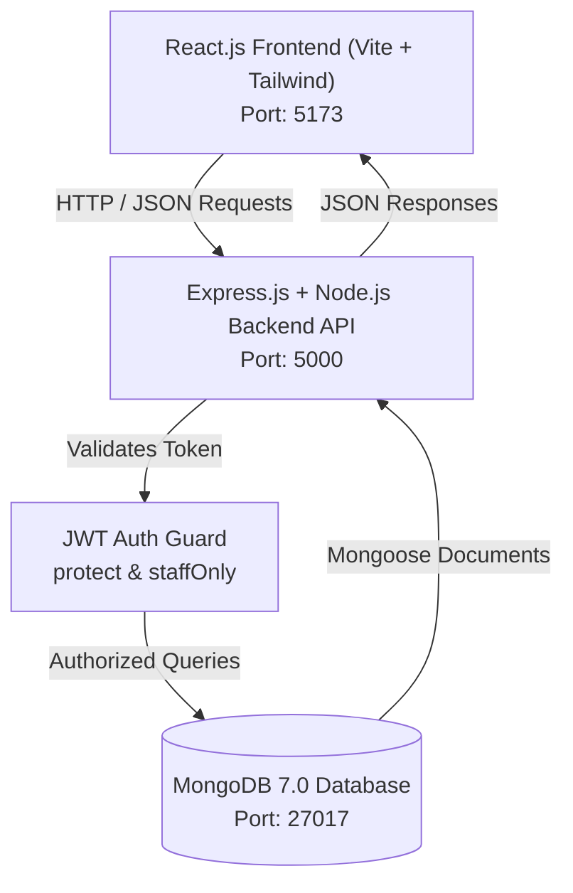
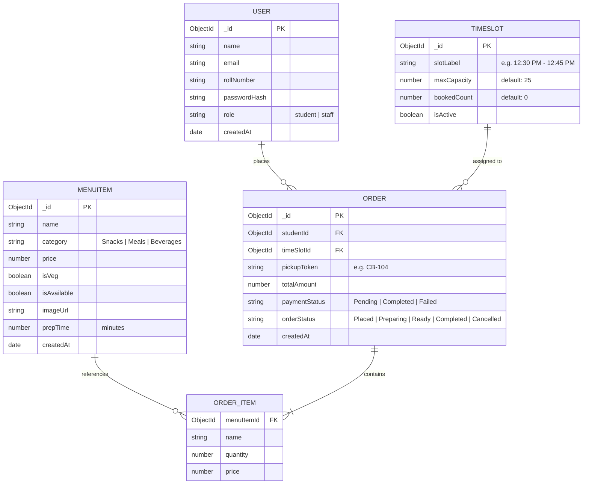
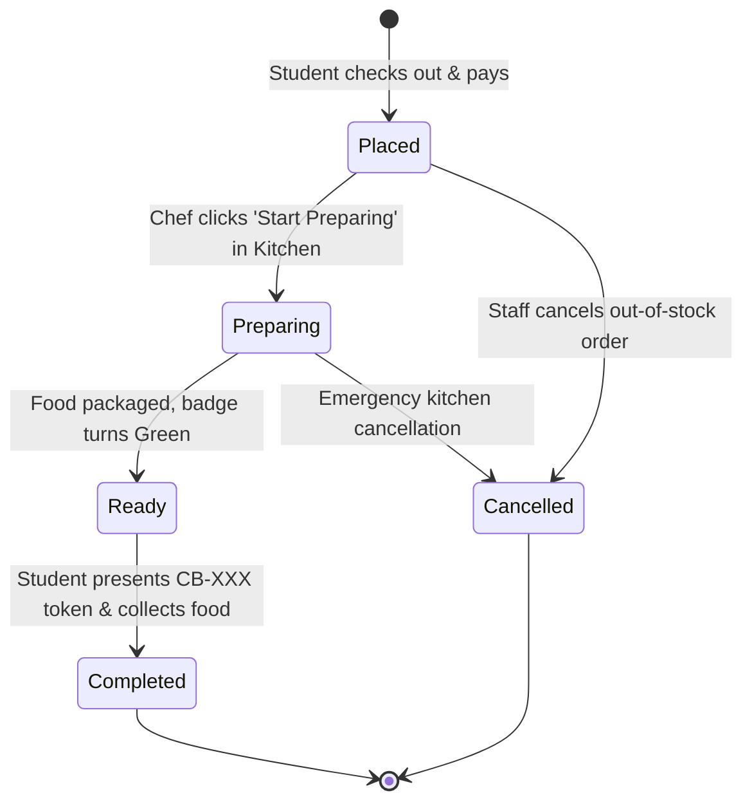
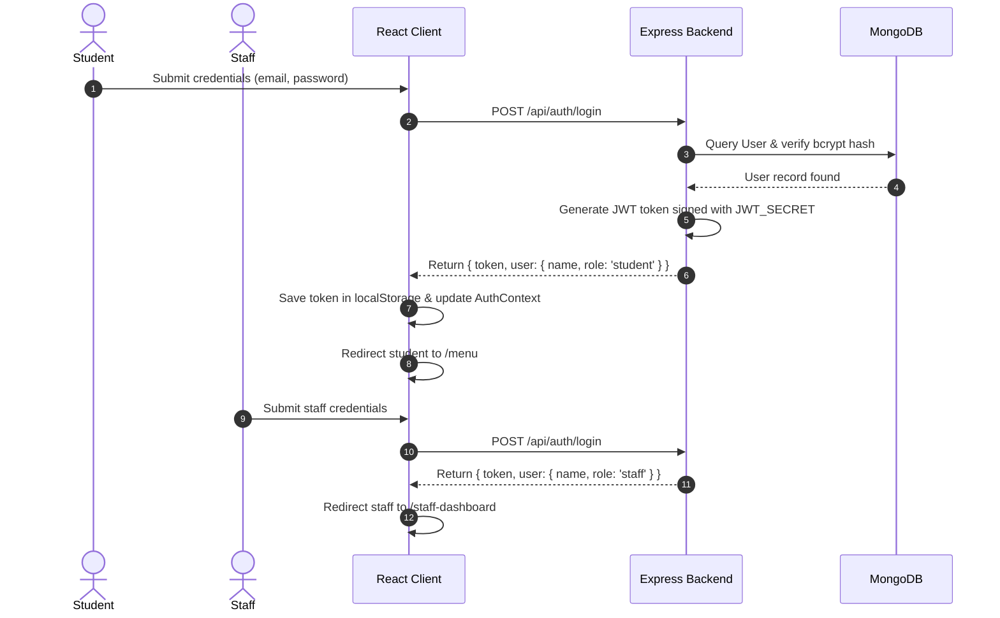

# 🏛️ CampusBite - Architecture & Database Design

This document details the software architecture, data models, state machines, and authentication flow for CampusBite.

---

## 1. High-Level System Architecture

CampusBite follows a decoupled 3-tier client-server architecture:

---

## 2. Database Schema & Entity Relationship Diagram (ERD)

---

## 3. Order Lifecycle State Machine

Each canteen order transitions through deterministic states tracked in real-time by students and staff:

---

## 4. Authentication & Role-Based Access Flow

